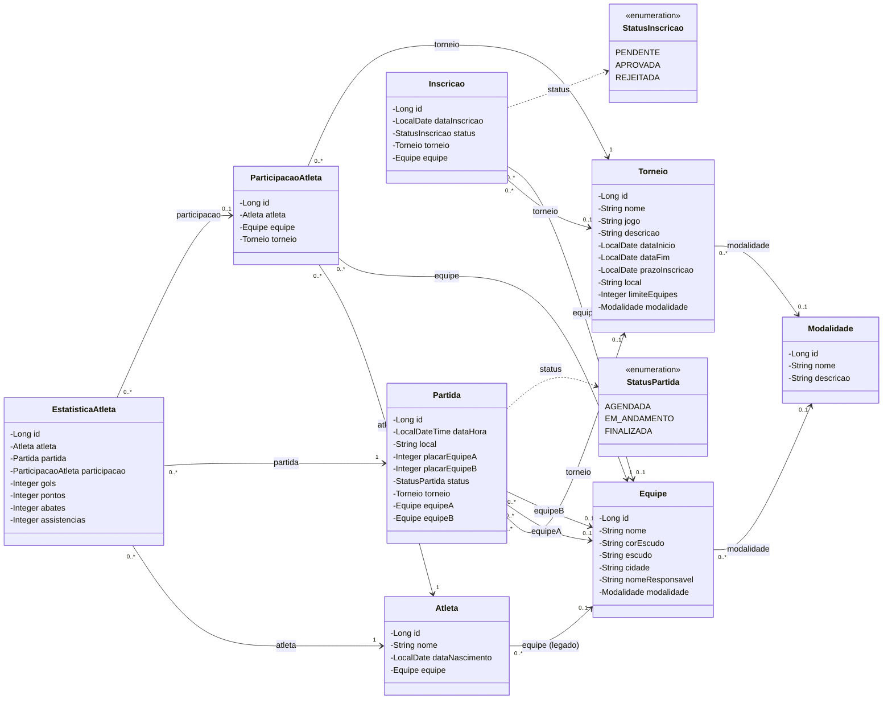

# Diagrama de classes — E-sports

Diagrama do modelo persistente conferido com as entidades do backend em 21/11/2026. Representa as oito classes anotadas com `@Entity` e os dois enums utilizados nos status. Controllers, services, repositories e DTOs não são entidades e ficaram fora deste desenho.

## Como ler

- `-` indica um atributo privado. Getters e setters gerados pelo Lombok foram omitidos.
- As setas contínuas mostram as referências `@ManyToOne`, do objeto que contém o atributo para o objeto referenciado. O texto da ligação é o nome desse atributo no Java.
- `0..*` significa zero ou muitos registros; `0..1`, uma referência opcional; `1`, uma referência obrigatória na persistência.
- As cardinalidades seguem o mapeamento das entidades, considerando `optional` e `nullable` explícitos. Algumas referências opcionais no mapeamento são obrigatórias nos serviços. Essa diferença está detalhada na [explicação do diagrama](explicacao-diagrama.md).
- As ligações pontilhadas indicam o uso de um enum, não um relacionamento entre tabelas.

## UML em Mermaid

## Restrições declaradas nas entidades

| Classe | Restrição ou valor inicial |
|---|---|
| Todas as entidades | `id` do tipo `Long`, com `@Id` e geração `IDENTITY`. |
| ParticipacaoAtleta | Restrição única para `(atleta_id, torneio_id)`: o atleta não pode ter duas participações na mesma competição, mesmo em equipes diferentes. |
| EstatisticaAtleta | Restrição única para `(atleta_id, partida_id)`: um registro individual por atleta e partida. |
| Equipe | `escudo` e `corEscudo` não permitem nulo. Valores iniciais: `VERDE` e `#7ED957`. |
| Inscricao | `status` inicia em `PENDENTE` e utiliza `EnumType.STRING`. |
| Partida | `status` inicia em `AGENDADA` e utiliza `EnumType.STRING`. |

Não há `@ManyToMany`, listas `@OneToMany`, herança, composição ou remoção em cascata declaradas nessas entidades. A multiplicidade `0..*` nas ligações não representa uma coleção Java inexistente: mostra que vários registros podem apontar para o mesmo objeto.

O desenho registra o código atual, não uma proposta de remodelagem. A conferência foi feita nos [arquivos das entidades](../../ecommerce-backend-4a-main/ecommerce-backend-4a-main/ecommerce/src/main/java/br/edu/unifio/ecommerce/entidades). Não foi feita alteração ou inspeção do banco nesta etapa.

[Ler a explicação do modelo](explicacao-diagrama.md) · [Voltar ao README principal](../../README.md)
